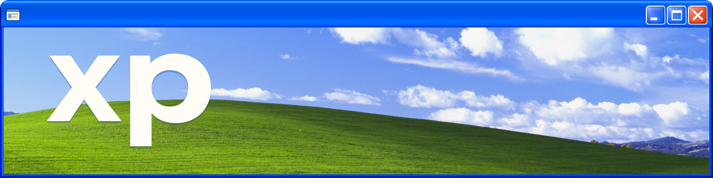
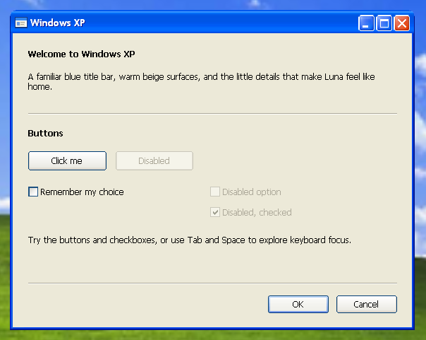

A small Go library for desktop windows with Windows XP's blue Luna look, plus a demo application. The frame and controls are custom-drawn, with DPI scaling, keyboard navigation and window-manager integration.



- Resizable windows and fixed-size dialogs.
- Labels, buttons, checkboxes and separators, with anchors for resizing.
- Windows support through Win32/GDI and Linux support through X11, including Wayland sessions with XWayland.

## Try the demo

Requires Go 1.27.3 or newer. From the repository root:

```sh
go run .
```

To build a fully static Linux binary, run on Linux with CGO disabled:

```sh
CGO_ENABLED=0 go build -o xp .
```

The Linux backend embeds its fonts and connects to the display through `DISPLAY`. Wayland sessions require XWayland.

## Use as a library

```sh
go get github.com/coalaura/xp
```

```go
package main

import (
	"image"
	"log"

	"github.com/coalaura/xp/ui"
	"github.com/coalaura/xp/window"
)

func main() {
	err := window.Run(window.Options{
		Title:  "Hello, Luna",
		Style:  window.Dialog,
		Width:  320,
		Height: 160,
		Controls: []ui.Control{
			{Kind: ui.Label, Bounds: image.Rect(20, 20, 290, 45), Text: "A little nostalgia, written in Go."},
			{ID: "close", Kind: ui.Button, Bounds: image.Rect(210, 80, 290, 105), Text: "OK", Default: true, Cancel: true},
		},
		OnClick: func(current window.Window, id string) {
			if id == "close" {
				current.Close()
			}
		},
	})
	if err != nil {
		log.Fatal(err)
	}
}
```

`window.Run` blocks until the window closes. Window dimensions include the frame; control bounds are relative to the content area. Both use logical pixels at 96 DPI.

Use `Anchor` to move or stretch controls when resizing, such as `ui.Right | ui.Bottom` for a bottom-right button. `Default` and `Cancel` assign Enter and Escape actions; Tab moves focus and Space activates the focused control.

In `OnClick`, use `SetText`, `Checked`, `SetChecked` or `Close` on the supplied window. Checkboxes toggle before the callback. Keep callbacks brief and call window methods only on the callback's UI thread.

See [`main.go`](main.go) for the full demo. [`window`](window) provides the desktop API, [`ui`](ui) defines controls and [`theme`](theme) contains the shared Luna renderer.

## License

[Mozilla Public License 2.0](LICENSE).
